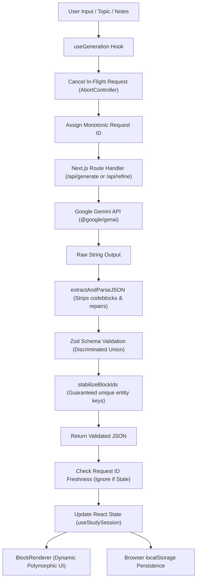

# ReWise — AI-Powered Active Learning Platform

> **Study smarter. Remember longer.**  
> Built for the Frontend Internship Assignment.

ReWise transforms unstructured lecture notes, educational articles, and textbook excerpts into structured, highly interactive active-learning blocks: **Conceptual Summaries**, **3D Flip Flashcards**, **Multiple-Choice Quizzes**, and **Revision Checklists** with dedicated **Wrong-Answer Retesting** and an **AI Refinement Loop**.

---

## 🌟 Key Features

- **Strict Structured AI Output (Not a Chatbot)**: Communicates with Google Gemini server-side via `@google/genai`, requesting structured JSON and enforcing strict Zod validation before rendering.
- **Defensive Error & Bad AI Output Handling (20% weight)**:
  - Markdown code-fence stripper and robust outermost JSON extractor.
  - Zod discriminated union schema validation.
  - Semantic range checks (e.g. ensuring `correctAnswerIndex` falls within options bounds).
  - Entity ID stabilization (does not rely on LLM to generate stable React keys).
  - Race condition prevention using monotonically increasing request IDs and `AbortController`.
  - Graceful fallback with user-friendly error banners and one-click retry.
- **3D Flip Flashcards with Keyboard Navigation**:
  - Interactive flip cards with active recall tracking (Mastered vs. Needs Review).
  - Keyboard shortcuts: `Space`/`Enter` to flip, `←`/`→` to navigate, `1` for Mastered, `2` for Review.
- **Multiple-Choice Quiz & Wrong-Answer Retesting**:
  - Instant option evaluation, score breakdown, and pedagogical explanations.
  - Dedicated **Wrong-Answer Retest**: isolates missed questions so learners can retry only what they got wrong, tracking score improvement across attempts.
  - Confetti celebration upon achieving 100% mastery.
- **Revision Checklists**:
  - Step-by-step revision milestones with real-time percentage progress.
- **AI Content Refinement Loop**:
  - Allows learners to refine and adapt active sessions (e.g., *"Make quiz questions harder"*, *"Add 4 more flashcards on edge cases"*, *"Simplify summary with analogies"*).
- **Corrupt-Proof Local Persistence**:
  - Automatically saves study sessions and learning progress to `localStorage`.
  - Validates stored data with Zod upon retrieval; gracefully sanitizes corrupted entries without crashing.
- **1-Click Demo & Offline Testing**:
  - Includes a pre-configured sample study session (*Operating Systems: CPU Scheduling & Synchronization*) for instant evaluation even without an API key.

---

## 🏗️ Architecture & Data Flow



---

## 📁 Project Structure

```
rewise/
├── app/
│   ├── api/
│   │   ├── generate/route.ts       # Secure Gemini structured generation endpoint
│   │   └── refine/route.ts         # Targeted iterative refinement endpoint
│   ├── layout.tsx                  # Root layout, dark mode, metadata
│   ├── page.tsx                    # Main interactive study dashboard
│   └── globals.css                 # Tailwind base styles and custom scrollbars
├── components/
│   ├── blocks/
│   │   ├── BlockRenderer.tsx       # Discriminated union block dispatcher
│   │   ├── SummaryBlock.tsx        # Executive summary and key takeaways
│   │   ├── FlashcardBlock.tsx      # 3D flip card with keyboard nav & mastery tags
│   │   ├── QuizBlock.tsx           # Multiple choice, feedback, and explanations
│   │   └── ChecklistBlock.tsx      # Revision tasks with progress tracking
│   ├── history/
│   │   └── SavedSessionsModal.tsx  # Manage, restore, rename, and delete sessions
│   ├── input/
│   │   ├── NotesInput.tsx          # Free-form input, difficulty, block selection
│   │   └── RefineBar.tsx           # Follow-up refinement prompt bar
│   ├── layout/
│   │   ├── Header.tsx              # Top bar, status, quick actions
│   │   ├── Sidebar.tsx             # Collapsible session history drawer
│   │   └── MainLayout.tsx          # Responsive responsive shell
│   ├── study/
│   │   ├── RetestSection.tsx       # Dedicated wrong-answer retesting interface
│   │   ├── SessionOverview.tsx     # Session title, difficulty, export, reload
│   │   └── StudyProgress.tsx       # Overall session mastery score gauge
│   └── ui/
│       ├── Badge.tsx               # Reusable difficulty and status pills
│       ├── Button.tsx              # Accessible button with states and variants
│       ├── Card.tsx                # Obsidian surface card container
│       ├── EmptyState.tsx          # Zero-state onboarding with sample topic chips
│       ├── ErrorAlert.tsx          # Resilient error alert with retry & diagnostics
│       └── Skeleton.tsx            # Loading skeletons for generation
├── hooks/
│   ├── useGeneration.ts            # Abortable API client with monotonic request IDs
│   ├── useKeyboardNav.ts           # Accessible keyboard shortcuts for flashcards
│   └── useStudySession.ts          # Central state owner for active session & scores
├── lib/
│   ├── gemini.ts                   # Google Gen AI SDK client and error translation
│   ├── mockData.ts                 # Offline / fallback mock dataset for demo/testing
│   ├── prompts.ts                  # Structured system prompts and pedagogical rules
│   ├── schemas.ts                  # Zod schemas for requests, responses, and storage
│   ├── storage.ts                  # LocalStorage serialization & corruption recovery
│   ├── studyLogic.ts               # Pure domain calculations (scores, retest, mastery)
│   └── validation.ts               # JSON cleaner, codeblock stripper, ID stabilizer
├── tests/
│   ├── retest.test.ts              # Scoring, wrong-answer retesting & stats tests
│   ├── schemas.test.ts             # Schema validation, bad AI output & edge cases
│   └── storage.test.ts             # LocalStorage corruption resilience tests
├── .env.example
├── package.json
├── tailwind.config.ts
├── tsconfig.json
└── vitest.config.ts
```

---

## 🛠️ Technology Stack

- **Framework**: Next.js 15 (App Router, Server Route Handlers)
- **Language**: TypeScript (Strict mode, zero implicit `any`)
- **Styling**: Tailwind CSS (Tailwind v3)
- **AI SDK**: Official `@google/genai` (Google Gen AI JavaScript SDK)
- **Model**: `gemini-2.5-flash` (Structured JSON output with low temperature)
- **Validation**: Zod (Discriminated unions, custom range refinements)
- **Icons**: Lucide React
- **Celebrations**: `canvas-confetti`
- **Testing**: Vitest + JSDOM

---

## 🚀 Getting Started

### 1. Fresh Checkout & Setup

```bash
# Clone the repository
git clone https://github.com/lokender11101/Re-Wise.git
cd Re-Wise

# Install dependencies
npm install
```

### 2. Configure Environment Variables

Create a `.env.local` file in the root directory:

```bash
cp .env.example .env.local
```

Add your Google Gemini API key (get a free key at [Google AI Studio](https://aistudio.google.com/)):

```env
GEMINI_API_KEY=your_actual_gemini_api_key_here
GEMINI_MODEL=gemini-2.5-flash
```

> **Note on API Security:** The `GEMINI_API_KEY` is accessed **strictly server-side** in Next.js route handlers (`app/api/*`) and is never leaked to the client bundle. `.env.local` is ignored by `.gitignore`.

### 3. Run the Application

Per the assignment specification, the application runs out of the box with:

```bash
npm start
```

*(Note: `npm start` automatically executes `prestart` to build `.next` if not already built, guaranteeing zero build missing errors).*

For local development with hot reload:

```bash
npm run dev
```

Open [http://localhost:3000](http://localhost:3000) in your browser.

---

## 🧪 Running Automated Tests

Run the complete Vitest test suite covering schema validation, edge cases, corrupted storage recovery, and wrong-answer retesting logic:

```bash
npm test
```

All 21 unit tests verify:
- Valid AI response schema compliance.
- Markdown fence stripping (````json ... ````).
- Outermost JSON extraction from model commentary.
- Rejection of malformed JSON syntax.
- Out-of-bounds `correctAnswerIndex` detection.
- Rejection of unknown block types.
- Automatic entity ID stabilization.
- Recovery from corrupted `localStorage` JSON syntax.
- Skipping corrupted stored sessions while preserving healthy ones.
- Scoring accuracy, wrong-answer filtering, and retest isolation.

---

## 🛡️ Failure Handling Strategy (20% Evaluation Weight)

| Failure Scenario | Mitigation & Implementation |
| :--- | :--- |
| **Malformed JSON** | `extractAndParseJSON` extracts outermost `{ ... }` brackets and strips markdown fences before parsing. |
| **Invalid Schema / Missing Fields** | Zod schema validation checks types and array bounds. Emits readable diagnostic paths. |
| **Out-of-Bounds Quiz Answer Index** | `.refine(q => q.correctAnswerIndex >= 0 && q.correctAnswerIndex < q.options.length)` ensures quiz questions never reference invalid options. |
| **Race Conditions** | `useGeneration` tracks monotonic `latestRequestIdRef` and cancels prior in-flight calls via `AbortController`. If a slow older request finishes after a faster newer request, the older result is safely discarded. |
| **Gemini Rate Limits (429) & Timeouts** | Server-side 30s timeout via `AbortController`. Errors are mapped to friendly HTTP status codes (`429`, `504`) with a one-click retry button. |
| **Corrupted `localStorage`** | `getSavedSessions` validates each session individually with Zod. Corrupted records are quarantined without crashing the app. |
| **Offline / Missing API Key** | App provides an **"Instant Demo"** button that pre-loads a full mock session for seamless evaluation without credentials. |

---

## 🤖 AI Usage Disclosure

In compliance with the assignment instructions:
- **AI Tools Used**: Used Claude/Gemini coding assistance for initial scaffolding, architectural planning, and generating synthetic pedagogical test fixtures.
- **Human Authorship & Decision Making**:
  - Designed the discriminated union data contract (`SummaryBlock`, `FlashcardBlock`, `QuizBlock`, `ChecklistBlock`).
  - Architected the dual-phase wrong-answer retesting mechanics and score improvement delta calculation.
  - Formulated the defensive JSON sanitization and Zod range validation pipelines.
  - Designed the custom hooks (`useGeneration`, `useStudySession`, `useKeyboardNav`) and race-condition prevention pattern.

---

## ⏳ Time Spent Breakdown (~8-Hour Budget)

- **Phase 1: Assignment Analysis & Architectural Blueprint** — 0.75h
- **Phase 2: Data Contracts, Zod Schemas & Vitest Suite** — 1.0h
- **Phase 3: Backend Routes & Server-Side Gemini SDK Integration** — 1.25h
- **Phase 4: Interactive Learning Blocks (Flashcards, Quiz, Checklist)** — 1.75h
- **Phase 5: Wrong-Answer Retest Engine & Study Progress Tracking** — 1.0h
- **Phase 6: Session Persistence & Corrupted Storage Recovery** — 0.75h
- **Phase 7: AI Refinement Loop & UI Polish** — 0.75h
- **Phase 8: Build Verification, Responsive Testing & Documentation** — 0.75h
- **Total Work Time**: **~8.0 hours**

---

## 📌 Known Limitations & Future Improvements

1. **Streaming Partial JSON**: The current release prioritizes data integrity and schema validation, buffering the complete model JSON before committing it to application state. Future versions could implement progressive JSON streaming using chunked parser libraries.
2. **Audio Pronunciation**: Adding Web Speech API integration to pronounce flashcard terms for language learning.
3. **Spaced Repetition (SM-2 Algorithm)**: Extending localStorage to schedule flashcard reviews at intervals (1 day, 3 days, 1 week) based on recall difficulty.

---

## 📄 License

MIT License. Developed for the Frontend Internship Assignment.
