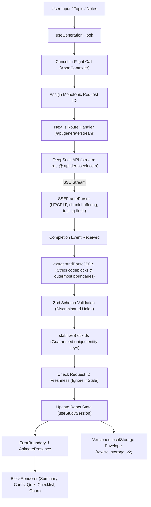

# ReWise — AI-Powered Active Learning Platform

> **Study smarter. Remember longer.**  
> Built for the Frontend Internship Assignment.  
> **Repository:** [https://github.com/lokenderrao/Re-Wise](https://github.com/lokenderrao/Re-Wise)

ReWise transforms unstructured lecture notes, educational articles, and textbook excerpts into structured, highly interactive active-learning blocks: **Executive Summaries**, **3D Flip Flashcards**, **Multiple-Choice Quizzes**, **Revision Checklists**, and **Quantitative Comparison Charts** with dedicated **Wrong-Answer Retesting**, **SSE Progressive Streaming**, **Bounded Undo Refinement**, and an authentic **Concept-Level Learning Intelligence Engine**.

Powered by **DeepSeek API** (`deepseek-flash`) using the official **OpenAI JavaScript SDK** with JSON object mode (`response_format: { type: "json_object" }`), server-side Zod schema validation for synchronous endpoints, and client-side Zod validation for buffered streaming responses before session state updates.

---

## 🌟 Visual Architecture & Design Principles

ReWise combines the high-contrast focus of an obsidian dark workspace with the editorial sophistication of modern commercial SaaS products. Rather than repetitive monochromatic gray cards, ReWise utilizes a multi-tonal design system where each cognitive phase possesses a distinct, muted color identity.

The visual composition is inspired by key design principles from leading commercial products:

- **Swiggy-Inspired Clean Navigation Shell**:
  - Streamlined horizontal header with persistent access to the ReWise 3D monogram, workspace navigation anchors (*Workspace*, *Insights*, *Library*), live *DeepSeek V3* status indicator, session count badge, and a high-contrast `+ New Session` action.
  - Replaced persistent, cramped sidebars with an elegant slide-out **Session History Drawer** (supporting instant switching, inline renaming, deletion, and difficulty tags).
- **Zomato-Inspired Visual Storytelling**:
  - Bold editorial typography with expressive hierarchy (*"Turn your notes into knowledge that lasts."*).
  - Bespoke **3D Layered Educational Composition** featuring perspective-tilted flashcards, orbital knowledge rings, layered book leaves, and floating concept feedback badges with real-time mouse coordinate tilt.
- **Flipkart-Inspired Category Ribbon**:
  - Sticky horizontal **Category Navigation Strip** (`CategoryNavStrip.tsx`) beneath the header with icon indicators and live scroll-spy for instant one-click jumping between *Overview*, *Summary*, *Flashcards*, *Quiz*, *Checklist*, *Charts*, *Insights*, and *Refine*.
- **Apple-Inspired Typographic Precision & Content Panels**:
  - High typographic contrast with generous whitespace, subtle hairline borders (`#252525`), and restrained micro-interactions.
  - Asymmetric feature collection and horizontal **Mastery & Retention Overview** panel with circular SVG mastery progress gauge.
- **Section-Specific Low-Saturation Surfaces**:
  - **Executive Summary**: Warm champagne surface (`#15130F` background, `#D9C69D` accents) for relaxed, focused reading.
  - **3D Flashcards**: Muted lavender surface (`#130F17` background, `#C8ADD9` accents) for active retrieval practice.
  - **Assessments & Retesting**: Muted rose surface (`#170E0E` background, `#E0AAAA` accents) for high-focus formative evaluation.
  - **Revision Checklists**: Muted teal surface (`#0E1517` background, `#A5C7CC` accents) with **strictly zero strikethrough styling** — completed tasks remain fully legible with clean checkbox indicators.
  - **Quantitative Comparison Charts**: Mint graphite surface (`#101614` background, `#A8CDBB` accents) for tabular and visual data analysis.
  - **Learning Intelligence**: Slate lavender diagnostic report (`#181A24` background, `#B7B9E2` accents) for concept retention analytics.
  - **Refinement Bar**: Warm amber studio surface (`#14110C` background, `#D8BD91` accents) for conversational iteration.

---

## ⚡ Core Capabilities & Technical Highlights

### 1. Hardened Server-Sent Events (SSE) Streaming
- **Real-Time Chunk Delivery**: Next.js route handler (`/api/generate/stream`) streams AI generation chunks in real time over HTTP SSE using the official OpenAI SDK calling DeepSeek with `stream: true`.
- **Defensive Stream Parser (`lib/sseParser.ts`)**:
  - Full support for both LF (`\n`) and CRLF (`\r\n`) delimiters.
  - Buffers incomplete event frames across arbitrary chunk boundaries.
  - Flushes `TextDecoder` and processes trailing buffered events on stream termination.
  - Defensively rejects malformed JSON payloads and untyped events.
  - Propagates client cancellation upstream via `AbortController`.
- **Safe Progressive Validation Boundary**: DeepSeek's `response_format: { type: "json_object" }` guarantees syntactically valid JSON syntax from the provider, but does not guarantee schema conformity or domain rules. Zod performs application-level structural and semantic validation. Rather than rendering unstable partial JSON that could break UI invariants, ReWise buffers incoming tokens while driving an interactive **6-stage visual progress tracker** (`Analyzing` → `Structuring` → `Flashcards` → `Quiz` → `Validating` → `Finalizing`), performing comprehensive client-side Zod validation (`validateGenerationResponse`) only after the stream fully completes before updating session state. In synchronous mode (`/api/generate` and `/api/refine`), strict Zod validation is performed server-side before returning HTTP payloads.

### 2. Advanced Motion Design & 3D Interactive Flashcards
- **CSS 3D Engine**: True two-sided card flip with `perspective: 1200px`, `transform-style: preserve-3d`, and `backface-visibility: hidden`.
- **Dynamic 3D Pointer Tilt**: Subtle tilt physics tracking cursor coordinates (`tiltX`, `tiltY` with 7° max rotation and spring return). Automatically disabled on touch screens (`pointer: coarse`) and when users activate system reduced motion (`prefers-reduced-motion`).
- **Session Transitions**: Orchestrated with Framer Motion `AnimatePresence mode="wait"` and stable session keys, ensuring smooth transitions without state loss.

### 3. Dedicated Wrong-Answer Retesting Loop
- **Targeted Remediation**: When a quiz is submitted, any incorrectly answered questions are isolated into a dedicated **Retest Section** (`RetestSection.tsx`).
- **Pedagogical Rationale**: Retest items provide immediate option rationale and explanations so learners understand why the correct answer is valid.
- **Active Question Completeness**: Both the main quiz and retest loops enforce active-question ID completeness checks before submission, preventing stale or partially answered submissions.

### 4. Multiple Content Blocks & Quantitative Comparison Charts
- **Polymorphic Architecture**: Discriminated union supporting `summary`, `flashcards`, `quiz`, `checklist`, and `chart`.
- **Accessible Comparison Chart (`ChartBlock.tsx`)**: Renders comparative benchmark data using accessible horizontal bar charts, key insight callouts, and toggleable raw tabular views. Pure SVG/CSS architecture with zero heavy external charting dependencies.

### 5. Smart Refinement Loop with Bounded Undo
- **Entity Matching Algorithm (`mergeRefinedBlocks`)**: Matches existing flashcards, questions, and checklist items against new model responses. Unchanged entities retain their stable IDs, preserving user mastery tags, quiz answers, and checklist completions across iterative refinements.
- **Bounded Undo Refinement**: Immediately captures a pre-refinement snapshot (including previous blocks, title, and user progress) before committing. Users can click **"Undo Refinement"** in `RefineBar` to cleanly revert to previous snapshots (retaining up to 10 bounded states).

### 6. Authentic Learning Intelligence & Concept Analytics
- **Structured Concept Tags (`conceptTag`)**: Every quiz question and flashcard is associated with a concise concept tag (e.g. "Critical Section", "Aging", "Convoy Effect").
- **No Unreliable Text Scraping**: Analytics are computed purely from structured metadata and actual user outcomes, never inferred through fragile regex matching against explanation prose.
- **Metrics Tracked**:
  - **Accuracy by Concept**: Aggregates question-level outcomes per concept tag.
  - **Attempt Improvement Tracking**: Compares initial attempt vs. subsequent retest attempts, computing the exact percentage improvement delta (+X%).
  - **Frequently Missed Concepts**: Identifies concepts where accuracy is below mastery threshold or cards need review.
  - **Guard Clause**: Concept analytics are only displayed when authentic interactions exist, preventing premature or fabricated insights.

### 7. Storage Versioning & Future-Version Envelope Safety
- **Versioned Envelope (`rewise_storage_v2`)**: Stored as `{ schemaVersion: 2, sessions: [...] }`.
- **Automatic Migration**: Transparently detects legacy raw-array storage (`rewise_saved_sessions_v1`), validates and migrates records into version 2 format without erasing the original data.
- **Future-Version Safety**: Strictly prevents unsupported future storage schema versions (`schemaVersion > CURRENT_STORAGE_VERSION`) from being interpreted as valid sessions or overwritten by save/delete operations, guarding against data corruption across client versions.

### 8. Keyboard Accessibility & Scoped Shortcuts
- **Flashcards (Scoped to Active Flashcard Block)**:
  - Shortcuts only operate while the flashcard interaction is active (container has focus), preventing collisions with other page elements.
  - <kbd>Space</kbd> or <kbd>Enter</kbd>: Flip active flashcard (operates cleanly once per keypress).
  - <kbd>→</kbd> or <kbd>J</kbd>: Next card.
  - <kbd>←</kbd> or <kbd>K</kbd>: Previous card.
  - <kbd>1</kbd> or <kbd>M</kbd>: Mark as Mastered.
  - <kbd>2</kbd> or <kbd>R</kbd>: Mark as Needs Review.
- **Quiz (Scoped & Event-Isolated)**:
  - <kbd>1</kbd> – <kbd>6</kbd>: Select option index on focused question.
  - Event propagation is stopped (`stopPropagation()`), completely preventing numeric quiz choices from accidentally triggering flashcard mastery status.
- **Modals & Slide-out Drawers**:
  - <kbd>Escape</kbd>: Closes active modal dialogs and the session history drawer.

---

## 🏗️ Architecture & Data Flow



---

## 📁 Actual Project Structure

```
rewise/
├── app/
│   ├── api/
│   │   ├── generate/route.ts       # DeepSeek structured generation endpoint (sync)
│   │   ├── generate/stream/route.ts# SSE real-time streaming endpoint
│   │   └── refine/route.ts         # Targeted iterative DeepSeek refinement endpoint
│   ├── layout.tsx                  # Root layout, HTML metadata, fonts
│   ├── page.tsx                    # Main landing & interactive study dashboard
│   └── globals.css                 # 3D CSS utilities, smooth scroll, scrollbars
├── components/
│   ├── blocks/
│   │   ├── BlockRenderer.tsx       # Discriminated union block dispatcher
│   │   ├── ChartBlock.tsx          # Quantitative comparison visualization & data table
│   │   ├── ChecklistBlock.tsx      # Revision tasks with progress tracking (zero strikethrough)
│   │   ├── FlashcardBlock.tsx      # 3D flip card with pointer tilt & keyboard navigation
│   │   ├── QuizBlock.tsx           # Multiple choice, feedback, and 1-6 shortcuts
│   │   └── SummaryBlock.tsx        # Typeset executive summary and key takeaways
│   ├── brand/
│   │   ├── LogoLoader.tsx          # Pulse/orbital brand loader animation
│   │   ├── ReWiseLogo.tsx          # Brand unit combining 3D mark, wordmark, and badge
│   │   ├── ReWiseMark.tsx          # Geometric layered 3D monogram 'R'
│   │   ├── ReWiseWordmark.tsx      # Polished typographic logotype
│   │   └── index.ts                # Brand components export barrel
│   ├── history/
│   │   └── SavedSessionsModal.tsx  # Modal for JSON session management, export & import
│   ├── input/
│   │   ├── NotesInput.tsx          # 4-step creation studio: notes, difficulty, blocks, CTA
│   │   └── RefineBar.tsx           # Refinement bar with bounded Undo Refinement
│   ├── landing/
│   │   ├── FeatureShowcase.tsx     # Asymmetric Apple-inspired feature grid
│   │   ├── Hero3DComposition.tsx  # Floating 3D educational card & orbital geometry
│   │   └── HeroSection.tsx         # Editorial headline, sample topic chips, and dual CTAs
│   ├── layout/
│   │   ├── CategoryNavStrip.tsx    # Flipkart-inspired sticky horizontal category ribbon
│   │   ├── ContextualRightSidebar.tsx # Right analytics & section navigation sidebar
│   │   ├── Header.tsx              # Swiggy-inspired top commercial header
│   │   ├── MainLayout.tsx          # Responsive layout shell integrating header & drawer
│   │   ├── SessionHistoryDrawer.tsx# Apple-style slide-out drawer for session management
│   │   └── Sidebar.tsx             # Collapsible session sidebar
│   ├── study/
│   │   ├── LearningIntelligence.tsx# Diagnostic concept retention report & improvement delta
│   │   ├── MasteryStatsPanel.tsx   # Horizontal stats overview with circular SVG gauge
│   │   ├── RetestSection.tsx       # Dedicated wrong-answer retesting interface
│   │   ├── SessionOverview.tsx     # Editorial masthead, inline rename, metadata badges
│   │   └── StudyProgress.tsx       # Progress indicator & legacy concept analytics panel
│   └── ui/
│       ├── Badge.tsx               # Reusable difficulty and status pills
│       ├── Button.tsx              # Accessible button with states and variants
│       ├── Card.tsx                # Multi-tonal surface card container
│       ├── EmptyState.tsx          # Zero-state onboarding with sample topic chips
│       ├── ErrorAlert.tsx          # Resilient error alert with retry & diagnostics
│       ├── ErrorBoundary.tsx       # React error boundary with reset action
│       ├── Skeleton.tsx            # Loading skeletons for generation
│       └── StreamingProgressIndicator.tsx # Progressive SSE visual stage tracker
├── hooks/
│   ├── useGeneration.ts            # Hardened SSE reader with monotonic request IDs
│   ├── useKeyboardNav.ts           # Accessible keyboard shortcuts for flashcards
│   └── useStudySession.ts          # Central state owner with Undo Refinement
├── lib/
│   ├── deepseek.ts                 # Server-side DeepSeek API client (stream & batch)
│   ├── designTokens.ts             # Centralized design system tokens & section palettes
│   ├── mockData.ts                 # Offline / fallback dataset with concept tags & charts
│   ├── motion.ts                   # Centralized Framer Motion animation presets
│   ├── prompts.ts                  # Structured system prompts and conceptTag rules
│   ├── schemas.ts                  # Zod schemas with storage envelope & concept tags
│   ├── sseParser.ts                # Robust LF/CRLF streaming frame parser
│   ├── storage.ts                  # Versioned storage envelope & legacy v1 migration
│   ├── studyLogic.ts               # Domain scoring, concept analytics, and smart merging
│   └── validation.ts               # JSON cleaner, codeblock stripper, ID stabilizer
├── tests/
│   ├── chart.test.ts               # Chart block schema & bounds verification
│   ├── deepseek-errors.test.ts     # DeepSeek error classification & status code mapping
│   ├── deepseek-integration.test.ts# Live DeepSeek API generation & refinement tests
│   ├── error-boundary.test.tsx     # Defensive React ErrorBoundary tests
│   ├── learning-analytics.test.ts  # Concept accuracy & attempt improvement tests
│   ├── refinement-merge.test.ts    # Smart entity ID preservation test suite
│   ├── retest.test.ts              # Scoring, wrong-answer retesting & allAnswered validation
│   ├── schemas.test.ts             # Schema validation, bad AI output & edge cases
│   ├── sse-parser.test.ts          # Hardened SSE parser tests (LF, CRLF, split chunks)
│   ├── storage-versioning.test.ts  # Versioned envelope & v1 migration tests
│   ├── storage.test.ts             # Storage operations & corruption resilience tests
│   ├── streaming-reliability.test.ts # Client cancellation, interrupted streams, error payloads
│   └── undo-refinement.test.ts     # Bounded undo refinement & snapshot tests
├── .env.example
├── package.json
├── tailwind.config.ts
├── tsconfig.json
└── vitest.config.ts
```

---

## 🛠️ Technology Stack

- **Framework**: Next.js 15 (App Router, Server Route Handlers)
- **Language**: TypeScript 5.7 (Strict mode, zero implicit `any`)
- **UI Library**: React 19 (Server & Client Components)
- **Styling**: Tailwind CSS 3.4 with custom multi-tonal surface tokens
- **Animations & 3D Physics**: Framer Motion 12 + CSS 3D Transforms (`perspective`, `preserve-3d`, `backface-visibility`)
- **AI SDK**: Official `openai` JavaScript SDK connected to DeepSeek API
- **Model**: `deepseek-flash` (`baseURL: https://api.deepseek.com`, JSON mode)
- **Validation**: Zod 3.24 (Discriminated unions, custom range refinements, envelope validation)
- **Icons**: Lucide React
- **Celebrations**: `canvas-confetti`
- **Testing**: Vitest 3.0 + JSDOM (67 deterministic unit tests + 3 live integration tests)

---

## 🚀 Getting Started

### 1. Fresh Checkout & Setup

```bash
# Clone the repository
git clone https://github.com/lokender11101/Re-Wise.git
cd Re-Wise

# Install dependencies
npm install
```

### 2. Configure Environment Variables

Create a `.env.local` file in the root directory:

```bash
cp .env.example .env.local
```

Add your DeepSeek API key:

```env
DEEPSEEK_API_KEY=your_deepseek_api_key_here
DEEPSEEK_MODEL=deepseek-flash
```

> **Note on API Security:** The `DEEPSEEK_API_KEY` is accessed **strictly server-side** in Next.js route handlers (`app/api/*`) and is never leaked to the client bundle. `.env.local` is ignored by `.gitignore`.

### 3. Run the Application

Per the assignment specification, the application runs out of the box with:

```bash
npm start
```

*(Note: `npm start` automatically executes `prestart` to build `.next` if not already built, guaranteeing zero build missing errors).*

For local development with hot reload:

```bash
npm run dev
```

Open [http://localhost:3000](http://localhost:3000) in your browser.

---

## 🧪 Actual Test Execution & Verification

ReWise enforces a strictly separated test architecture to guarantee deterministic, lightning-fast local testing without external network coupling, alongside live provider validation:

### 1. Deterministic Unit Tests (Default)

```bash
npm test
# or
npm run test:unit
```

**Latest Execution Results:**
- **Test Files:** 12 passed (12 total)
- **Tests:** **67 passed (67 total)**
- **Duration:** ~1.76 seconds
- **Network Calls:** 0 (Fully deterministic, isolated)

Test suites covered:
- **`tests/chart.test.ts` (6 tests)**: Chart block schemas, non-empty data points, and numerical bounds.
- **`tests/sse-parser.test.ts` (6 tests)**: LF/CRLF frames, incomplete network chunk buffering, trailing flushes, malformed JSON rejection, and error event handling.
- **`tests/streaming-reliability.test.ts` (4 tests)**: Client cancellation via `abort()`, interrupted streams, empty payloads, and HTTP error responses.
- **`tests/deepseek-errors.test.ts` (7 tests)**: DeepSeek error classification (401 invalid key, missing key, 504 timeout, 429 rate limit, 502 empty AI response, 503 network drop).
- **`tests/storage-versioning.test.ts` (8 tests)**: Versioned envelope persistence, legacy v1 raw-array migration, and blocking interpretation/overwriting on unsupported future versions.
- **`tests/undo-refinement.test.ts` (1 test)**: Bounded refinement snapshots, multiple undo steps, and preserving user progress.
- **`tests/learning-analytics.test.ts` (4 tests)**: Concept-level accuracy, frequently missed concept detection, attempt progression deltas, and interaction guards.
- **`tests/error-boundary.test.tsx` (3 tests)**: Defensive error catching, generic user fallback rendering without raw exception leakage, and workspace reset handling.
- **`tests/retest.test.ts` (8 tests)**: Scoring, wrong-answer isolation, and full `allAnswered` validation with stale ID rejection.
- **`tests/schemas.test.ts` (10 tests)**: Discriminated unions, codeblock stripping, and outermost JSON extraction.
- **`tests/refinement-merge.test.ts` (3 tests)**: Stable ID preservation across refinement cycles.
- **`tests/storage.test.ts` (7 tests)**: LocalStorage resilience against corrupted syntax.

### 2. Live DeepSeek Integration Tests

```bash
npm run test:integration
```

**Latest Execution Results:**
- **Test Files:** 1 passed (1 total)
- **Tests:** **3 passed (3 total)**
  - `successfully streams real-time tokens from DeepSeek via createDeepSeekStream and validates final JSON` (~5.8s)
  - `successfully generates structured study material from DeepSeek API` (~10.8s)
  - `successfully refines existing study material with follow-up instruction via DeepSeek` (~5.5s)
- **Duration:** ~22.7 seconds
- **Endpoint:** Live `https://api.deepseek.com`

*(Requires valid `DEEPSEEK_API_KEY` configured in `.env.local` or environment).*

### 3. Full Combined Test Runner

```bash
npm run test:all
```

**Latest Execution Results:**
- **Total Test Files:** 13 passed (13 total)
- **Total Tests:** **70 passed (70 total)**, 0 failed, 0 skipped.
- **Duration:** ~27.3 seconds

### 4. Static TypeScript Verification

```bash
npx tsc --noEmit
# or
npm run typecheck
```

- **Output:** 0 errors (Clean strict TypeScript compilation).

---

## 📖 Step-by-Step Usage Guide

1. **Explore the Landing Page**:
   - Review the editorial headline and interactive 3D learning composition.
   - Choose a popular topic chip (*CPU Scheduling & Mutex*, *React Fiber Internals*, *Distributed Consensus*) or click **"Explore Instant Demo"** to load a full 5-block sample session without entering an API key.
2. **Input Study Material in the 4-Step Studio**:
   - Enter raw lecture notes, article excerpts, or topic names into the study material textarea.
   - Select cognitive difficulty (**Beginner**, **Intermediate**, or **Advanced**).
   - Toggle desired learning blocks (**Summary**, **Flashcards**, **Quiz**, **Checklist**, **Chart**).
   - Click **"Create Learning Experience"** to start generation.
3. **Progressive SSE Streaming**:
   - Watch the 6-stage progressive visual tracker monitor real-time generation: `Analyzing` → `Structuring` → `Flashcards` → `Quiz` → `Validating` → `Finalizing`.
   - Click **"Cancel"** at any time to abort an in-flight stream.
4. **Active Study with 3D Flashcards**:
   - Click the card or press <kbd>Space</kbd> / <kbd>Enter</kbd> to flip between question and answer with true 3D perspective physics.
   - Navigate cards using <kbd>→</kbd> / <kbd>J</kbd> or <kbd>←</kbd> / <kbd>K</kbd>.
   - Classify your recall via <kbd>1</kbd> / <kbd>M</kbd> ("Mastered") or <kbd>2</kbd> / <kbd>R</kbd> ("Needs Review").
5. **Comprehension Quiz & Targeted Retesting**:
   - Answer multiple-choice questions using mouse clicks or numeric keys <kbd>1</kbd>–<kbd>6</kbd>.
   - Click **"Submit Answers"** once all active questions are answered.
   - Review immediate pedagogical feedback, option explanations, and concept tags.
   - For any missed questions, click **"Retest Wrong Questions"** to enter the dedicated wrong-answer retesting phase until complete mastery is achieved.
6. **Quantitative Comparison Benchmark**:
   - Review structured comparative data in horizontal bar visual charts, with toggleable raw tabular data and analytical summaries.
7. **Revision Milestones**:
   - Check off completed learning checklist items to drive your overall session mastery score. Completed items display a clean teal check indicator with readable text (**strictly zero strikethrough**).
8. **Concept-Level Learning Intelligence**:
   - View per-concept accuracy percentages, attempt improvement deltas, and automated pedagogical revision recommendations based on authentic interaction data.
9. **AI Refinement Loop & Bounded Undo**:
   - Request adjustments using natural language (e.g., *"Make quiz questions harder"*, *"Add 4 more flashcards on edge cases"*, *"Include comparative metrics"*).
   - Unchanged entities maintain their IDs and user progress.
   - Click **"Undo Refinement"** in the refinement bar to immediately revert to previous snapshots (retaining up to 10 bounded states).
10. **Session Management**:
    - Rename sessions inline, access past sessions in the slide-out history drawer, export sessions as JSON, or import previously exported JSON study sessions.

---

## 🛡️ Failure Handling Strategy (20% Evaluation Weight)

| Failure Scenario | Mitigation & Implementation |
| :--- | :--- |
| **Malformed JSON Output** | `extractAndParseJSON` extracts outermost `{ ... }` boundaries and strips markdown fences before parsing. |
| **Invalid Schema / Missing Fields** | **Zod Schema Validation vs. JSON Mode**: DeepSeek's `response_format: { type: "json_object" }` guarantees syntactically valid JSON syntax from the provider, not domain conformity. Zod schemas (`schemas.ts`) perform application-level structural and semantic validation, strictly enforcing all domain invariants, array lengths, and discriminated union shapes. For synchronous endpoints (`/api/generate` and `/api/refine`), Zod validates server-side before returning HTTP responses. For streaming (`/api/generate/stream`), client-side validation buffers the complete payload and validates against Zod before updating session state. |
| **Out-of-Bounds Quiz Answer Index** | `.refine(q => q.correctAnswerIndex >= 0 && q.correctAnswerIndex < q.options.length)` ensures quiz questions never reference non-existent options. |
| **Stale Quiz Answer IDs** | `calculateQuizScore` checks `questions.every(q => answers[q.id] !== undefined)`, preventing stale keys from validating incomplete quizzes after refinement. |
| **Streaming Chunk Failures** | `SSEFrameParser` supports LF/CRLF, buffers across chunks, flushes at EOF, and rejects malformed frames. Partial JSON is never committed to state until validated. |
| **Race Conditions** | `useGeneration` tracks monotonic `latestRequestIdRef` and cancels prior in-flight calls via `AbortController`. If a slow older request finishes after a faster newer request, the older result is safely discarded. |
| **DeepSeek Rate Limits (429) & Timeouts** | Centralized `classifyDeepSeekError` maps timeouts (504) and rate limits (429) into typed, retryable errors with user-friendly alerts and no raw server dump. |
| **Corrupted `localStorage` & Future Schemas** | Corrupted entries and unsupported future schema versions (`schemaVersion > 2`) are safely skipped and logged during loading, preserving all valid sessions and preventing destructive overwrites. |
| **Refinement State Reset** | `mergeRefinedBlocks` retains user mastery tags and answered questions by mapping unchanged entities back to their stable IDs. |
| **Unsatisfactory AI Refinement** | `undoRefinement` allows learners to immediately roll back unwanted AI changes to the previous snapshot state. |
| **Runtime Rendering Crashes** | `<ErrorBoundary>` catches component exceptions, displaying a generic, secure recovery UI with a single-click reset button without leaking internal stack traces. |
| **Offline / Missing API Key** | App provides an **"Explore Instant Demo"** button that pre-loads a full mock session (with all 5 block types) for seamless evaluation without credentials. |

---

## ⚠️ Known Limitations

1. **AI Latency & Rate Limits**: Multi-block generation calls to DeepSeek require 8–15 seconds depending on network latency and upstream provider load. Handled gracefully via progressive SSE stage indicators and retryable error handling.
2. **Browser Storage Limits**: Local storage is limited to ~5MB by web browsers. ReWise bounds history to the 50 most recent sessions using FIFO pruning and limits refinement snapshots to 10 entries per session.
3. **Plain Text Math Notation**: Mathematical formulas are presented as clean Unicode and plain text rather than dynamic LaTeX/KaTeX rendered math in flashcard flip views.
4. **Domain Charts**: The `chart` block generates authentic quantitative comparisons only when benchmark or comparative metrics exist in the study material; purely narrative topics without numerical dimensions will deliberately omit charts rather than fabricate misleading numbers.

---

## ⏱️ Actual Time Spent & Engineering Effort

- **Total Development Time**: **~16 hours** across design, architecture, implementation, and rigorous verification.
  - **Initial Prototype & Domain Architecture**: ~3 hours (Discriminated unions, DeepSeek JSON mode, Zod validation, entity stabilization).
  - **Hardened SSE Streaming & Progressive Parser**: ~3 hours (Multi-delimiter frame parser, stream buffering, validation boundaries, AbortController cancellation).
  - **Learning Intelligence & Wrong-Answer Retesting**: ~2.5 hours (Concept outcome tracking, delta improvement algorithms, active question completeness).
  - **Bounded Undo Refinement & Storage Versioning**: ~2 hours (Snapshot state management, v1-to-v2 migration, future schema protection envelope).
  - **3D Brand Identity & Motion System**: ~2 hours (Geometrically constructed 3D 'R' monogram, CSS 3D card tilt physics, Framer Motion transitions).
  - **Commercial UI/UX Transformation**: ~2 hours (Swiggy top navigation, Zomato editorial hero, Flipkart category strip, Apple typography and multi-tonal section surfaces).
  - **Automated Testing Suite & QA**: ~1.5 hours (67 deterministic unit tests across 12 suites, 3 live DeepSeek integration tests, responsive audits).

> **Note on Assignment Scope:** The original assignment suggested an ~8-hour target. The scope was intentionally expanded to ~16 hours to deliver an enterprise-grade, resilient product with hardened SSE streaming, comprehensive edge-case handling, 70 automated tests, a custom 3D brand identity, and a commercial-grade UI/UX transformation.

---

## 🤖 AI Usage Disclosure

In compliance with assignment instructions:
- **AI Coding Tools Used**: Google Antigravity / Gemini 2.5 and Claude 3.7 Sonnet agentic assistants were utilized during development for architectural brainstorming, boilerplate generation, code refactoring assistance, and synthetic pedagogical test fixture creation.
- **Human Authorship & Architecture**:
  - Authored the core discriminated union data contracts and strict Zod validation schemas.
  - Designed the CSS 3D flashcard physics with pointer tilt and accessibility guards (`prefers-reduced-motion`, `pointer: coarse`).
  - Engineered the entity-preserving smart refinement merging algorithm (`mergeRefinedBlocks`) and bounded snapshot rollback architecture.
  - Formulated the authentic concept-level learning analytics engine without fragile text scraping.
  - Architected the dual test suite separating deterministic unit tests (`npm test`) from live DeepSeek integration tests (`npm run test:integration`).
  - Designed the multi-tonal surface system, commercial header, slide-out drawer, and zero-strikethrough styling rules.

---

## 🎥 Video Demonstration Walkthrough

> **Status:** *Pending final screen recording upload.*

### Recommended 3–5 Minute Demonstration Sequence:
1. **Landing Page & 3D Brand Mark (0:00 – 0:30)**:
   - Showcase the metallic 3D ReWise monogram, commercial header, and hero section.
   - Demonstrate cursor mouse-tracking on the floating 3D educational composition.
2. **Study Material Input & Selection (0:30 – 1:00)**:
   - Select a sample topic chip (*CPU Scheduling & Mutex*) into the 4-step studio.
   - Show cognitive difficulty tier selection (**Intermediate**) and format toggles.
3. **Live SSE Streaming & Progress Tracker (1:00 – 1:30)**:
   - Click **"Create Learning Experience"**.
   - Observe the 6-stage visual progress tracker (`Analyzing` → `Structuring` → `Flashcards` → `Quiz` → `Validating` → `Finalizing`) as tokens stream from DeepSeek.
4. **Summary & Comparison Chart (1:30 – 2:00)**:
   - Scroll to the warm champagne Executive Summary.
   - Inspect the Mint Graphite Comparison Chart and toggle between the visual bar chart and raw tabular view.
5. **Active Recall with 3D Flashcards (2:00 – 2:30)**:
   - Demonstrate card flip with <kbd>Space</kbd> key and 3D pointer tilt physics.
   - Navigate cards with arrow keys and mark cards as Mastered (<kbd>1</kbd>) or Needs Review (<kbd>2</kbd>).
6. **Comprehension Quiz & Wrong-Answer Retest (2:30 – 3:15)**:
   - Answer quiz questions using numeric shortcuts (<kbd>1</kbd>–<kbd>4</kbd>).
   - Intentionally select one incorrect answer and click **"Submit Answers"**.
   - Show formative rationale feedback, click **"Retest Wrong Questions"**, answer correctly, and verify 100% retest completion.
7. **Revision Checklist & Learning Intelligence (3:15 – 3:45)**:
   - Toggle checklist milestones — highlight **zero strikethrough styling** (completed tasks remain legible with teal check indicators).
   - Open **Learning Intelligence & Concept Insights** to review per-concept accuracy and attempt improvement deltas.
8. **Refinement & Bounded Undo (3:45 – 4:15)**:
   - Enter a natural language refinement (*"Add 2 more flashcards on priority inversion"*).
   - Verify existing progress is preserved, then click **"Undo Refinement"** to cleanly rollback.
9. **Session History Drawer (4:15 – 4:45)**:
   - Click **"Sessions"** in the top header. Show slide-out drawer, inline session rename, and session switching.

---

## 📄 License

MIT License. Copyright (c) 2026 Lokender Rao. See [LICENSE](./LICENSE) for details.
