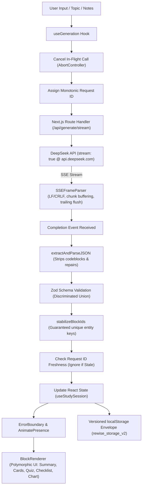

# ReWise — AI-Powered Active Learning Platform

> **Study smarter. Remember longer.**  
> Built for the Frontend Internship Assignment.

ReWise transforms unstructured lecture notes, educational articles, and textbook excerpts into structured, highly interactive active-learning blocks: **Conceptual Summaries**, **3D Flip Flashcards**, **Multiple-Choice Quizzes**, **Revision Checklists**, and **Quantitative Comparison Charts** with dedicated **Wrong-Answer Retesting**, **SSE Progressive Streaming**, **Bounded Undo Refinement**, and an authentic **Concept-Level Learning Intelligence Engine**.

Powered by **DeepSeek API** (`deepseek-flash`) using the official **OpenAI JavaScript SDK** with strict JSON Schema output mode and client-side Zod validation.

---

## 🌟 Key Capabilities & Stretch Implementations

### 1. Minimalist Monochromatic Dark Design System
- **Pure Black Aesthetic**: Designed with an ultra-clean, ChatGPT-inspired aesthetic (`#050505` canvas, `#101010` primary cards, `#141414` secondary surfaces, `#252525` hairline borders).
- **Zero Distracting Colors**: Replaced all saturated purples, blues, and neon gradients with monochromatic hierarchy, high-contrast white typography (`#F5F5F5`), and neutral gray secondary accents (`#A3A3A3`, `#737373`).

### 2. Advanced Motion Design & 3D Interactive Flashcards
- **CSS 3D Engine**: True two-sided card flip with `perspective: 1200px`, `transform-style: preserve-3d`, and `backface-visibility: hidden`.
- **Dynamic 3D Pointer Tilt**: Smooth, subtle tilt physics tracking cursor coordinates (`tiltX`, `tiltY` with 7° max rotation and spring return). Automatically disabled on touch screens (`pointer: coarse`) and when users activate system reduced motion (`prefers-reduced-motion`).
- **Session Switching Animation**: Orchestrated with Framer Motion `AnimatePresence mode="wait"` and stable session keys, ensuring smooth, subtle transitions without state loss.

### 3. Hardened Server-Sent Events (SSE) Streaming Generation
- **Real-Time Chunk Delivery**: Next.js route handler (`/api/generate/stream`) streams AI generation chunks in real time over HTTP SSE using official OpenAI SDK calling DeepSeek with `stream: true`.
- **Defensive Stream Parser (`lib/sseParser.ts`)**:
  - Full support for both LF (`\n`) and CRLF (`\r\n`) delimiters.
  - Buffers incomplete event frames across arbitrary chunk boundaries.
  - Flushes `TextDecoder` and processes trailing buffered events on stream termination.
  - Defensively rejects malformed JSON payloads and untyped events.
  - Propagates client cancellation upstream via `AbortController`.
- **Safe Progressive Validation Boundary**: Solves the core challenge of streaming structured JSON. Rather than rendering unstable partial JSON that could break UI invariants, ReWise buffers incoming tokens while driving an interactive **6-stage visual progress tracker** (`Analyzing`, `Structuring`, `Flashcards`, `Quiz`, `Validating`, `Finalizing`), validating with Zod only upon completion.

### 4. Multiple Content Blocks & Quantitative Chart Block
- **Polymorphic Architecture**: Discriminated union supporting `summary`, `flashcards`, `quiz`, `checklist`, and `chart`.
- **Accessible Comparison Chart (`ChartBlock.tsx`)**: Renders comparative benchmark data using accessible horizontal bar charts, key insight callouts, and toggleable raw tabular views. Pure SVG/CSS architecture with zero heavy charting dependencies.

### 5. Smart Refinement Loop with Bounded Undo Refinement
- **Entity Matching Algorithm (`mergeRefinedBlocks`)**: Matches existing flashcards, questions, and checklist items against new model responses. Unchanged entities retain their stable IDs, preserving user mastery tags, quiz answers, and checklist completions across iterative refinements.
- **Bounded Undo Refinement**: Immediately captures a pre-refinement snapshot (including previous blocks, title, and user progress) before committing. Users can click **"Undo Refinement"** in `RefineBar` to cleanly revert to previous snapshots (retaining up to 10 bounded states).

### 6. Authentic Learning Intelligence & Concept Analytics
- **Structured Concept Tags (`conceptTag`)**: Every quiz question and flashcard is associated with a concise concept tag (e.g. "Critical Section", "Convoy Effect", "Aging").
- **No Unreliable Text Scraping**: Analytics are computed purely from structured metadata and actual user outcomes, never inferred through fragile regex matching against explanation prose.
- **Deep Performance Metrics**:
  - **Accuracy by Concept**: Aggregates question-level outcomes per concept tag.
  - **Attempt Improvement Tracking**: Compares initial attempt vs. subsequent/retest attempts, computing the exact percentage improvement delta (+X%).
  - **Frequently Missed Concepts**: Identifies concepts where accuracy is below mastery threshold or cards need review.
  - **Guard Clause**: Concept analytics are only displayed when enough authentic interactions exist, preventing premature or fabricated insights.

### 7. Storage Versioning & Envelope Migration
- **Versioned Envelope (`rewise_storage_v2`)**: Stored as `{ schemaVersion: 2, sessions: [...] }`.
- **Automatic Migration**: Transparently detects legacy raw-array storage (`rewise_saved_sessions_v1`), validates and migrates records into version 2 format without erasing the original data.
- **Future-Proof**: Detects and handles unsupported future schema versions in safe read-only mode without overwriting.

### 8. Defensive React Error Boundary
- **Isolated Workspace Protection**: Wraps the interactive dashboard in a resilient `<ErrorBoundary>` component (`components/ui/ErrorBoundary.tsx`).
- **Sanitized User Messaging**: Displays a clean monochromatic failure card with a "Reset Workspace & Retry" recovery action, guarding against unhandled runtime crashes without leaking sensitive server stack traces.

### 9. Keyboard Accessibility Matrix
- **Flashcards**:
  - <kbd>Space</kbd> or <kbd>Enter</kbd>: Flip active flashcard.
  - <kbd>→</kbd> or <kbd>J</kbd>: Next card.
  - <kbd>←</kbd> or <kbd>K</kbd>: Previous card.
  - <kbd>1</kbd>: Mark as Mastered.
  - <kbd>2</kbd>: Mark as Needs Review.
- **Quiz**:
  - <kbd>1</kbd> – <kbd>6</kbd>: Select option index (automatically guarded against active text inputs).
- **Modals**:
  - <kbd>Escape</kbd>: Close active modal dialog.

---

## 🏗️ Architecture & Data Flow



---

## 📁 Project Structure

```
rewise/
├── app/
│   ├── api/
│   │   ├── generate/route.ts       # DeepSeek structured generation endpoint
│   │   ├── generate/stream/route.ts# SSE real-time streaming endpoint
│   │   └── refine/route.ts         # Targeted iterative DeepSeek refinement endpoint
│   ├── layout.tsx                  # Root layout, dark mode, metadata
│   ├── page.tsx                    # Main interactive study dashboard
│   └── globals.css                 # 3D CSS utilities and monochrome theme
├── components/
│   ├── blocks/
│   │   ├── BlockRenderer.tsx       # Discriminated union block dispatcher
│   │   ├── SummaryBlock.tsx        # Executive summary and key takeaways
│   │   ├── FlashcardBlock.tsx      # 3D flip card with pointer tilt & keyboard nav
│   │   ├── QuizBlock.tsx           # Multiple choice, feedback, and 1-6 shortcuts
│   │   ├── ChecklistBlock.tsx      # Revision tasks with progress tracking
│   │   └── ChartBlock.tsx          # Quantitative comparison visualization & table
│   ├── history/
│   │   └── SavedSessionsModal.tsx  # Manage, export, and import JSON sessions
│   ├── input/
│   │   ├── NotesInput.tsx          # Free-form input, difficulty, block selection
│   │   └── RefineBar.tsx           # Refinement prompt bar with Undo Refinement
│   ├── layout/
│   │   ├── Header.tsx              # Top bar, status, quick actions
│   │   ├── Sidebar.tsx             # Collapsible session history drawer
│   │   └── MainLayout.tsx          # Responsive layout shell
│   ├── study/
│   │   ├── RetestSection.tsx       # Dedicated wrong-answer retesting interface
│   │   ├── SessionOverview.tsx     # Session title, difficulty, export, reload
│   │   └── StudyProgress.tsx       # Mastery score & Concept Analytics Panel
│   └── ui/
│       ├── Badge.tsx               # Reusable difficulty and status pills
│       ├── Button.tsx              # Accessible button with states and variants
│       ├── Card.tsx                # Obsidian surface card container
│       ├── EmptyState.tsx          # Zero-state onboarding with sample topic chips
│       ├── ErrorAlert.tsx          # Resilient error alert with retry & diagnostics
│       ├── ErrorBoundary.tsx       # React error boundary with reset action
│       ├── Skeleton.tsx            # Loading skeletons for generation
│       └── StreamingProgressIndicator.tsx # Progressive SSE visual stage tracker
├── hooks/
│   ├── useGeneration.ts            # Hardened SSE reader with monotonic request IDs
│   ├── useKeyboardNav.ts           # Accessible keyboard shortcuts for flashcards
│   └── useStudySession.ts          # Central state owner with Undo Refinement
├── lib/
│   ├── deepseek.ts                 # Clean server-side DeepSeek API client (stream & batch)
│   ├── mockData.ts                 # Offline / fallback dataset with concept tags & charts
│   ├── motion.ts                   # Centralized Framer Motion animation presets
│   ├── prompts.ts                  # Structured system prompts and conceptTag rules
│   ├── schemas.ts                  # Zod schemas with storage envelope & concept tags
│   ├── sseParser.ts                # Robust LF/CRLF streaming frame parser
│   ├── storage.ts                  # Versioned storage envelope & legacy v1 migration
│   ├── studyLogic.ts               # Domain scoring, concept analytics, and smart merging
│   └── validation.ts               # JSON cleaner, codeblock stripper, ID stabilizer
├── tests/
│   ├── chart.test.ts               # Chart block schema & bounds verification
│   ├── deepseek-integration.test.ts# Live DeepSeek API generation & refinement tests
│   ├── error-boundary.test.tsx     # Defensive React ErrorBoundary tests
│   ├── learning-analytics.test.ts  # Concept accuracy & attempt improvement tests
│   ├── refinement-merge.test.ts    # Smart entity ID preservation test suite
│   ├── retest.test.ts              # Scoring, wrong-answer retesting & allAnswered validation
│   ├── schemas.test.ts             # Schema validation, bad AI output & edge cases
│   ├── sseParser.test.ts           # Hardened SSE parser tests (LF, CRLF, split chunks)
│   ├── storage-versioning.test.ts  # Versioned envelope & v1 migration tests
│   ├── storage.test.ts             # Storage operations & corruption resilience tests
│   └── undo-refinement.test.ts     # Bounded undo refinement & snapshot tests
├── .env.example
├── package.json
├── tailwind.config.ts
├── tsconfig.json
└── vitest.config.ts
```

---

## 🛠️ Technology Stack

- **Framework**: Next.js 15 (App Router, Server Route Handlers)
- **Language**: TypeScript (Strict mode, zero implicit `any`)
- **Styling**: Tailwind CSS (Monochrome Dark System)
- **Animations & 3D**: Framer Motion + CSS 3D Transforms (`perspective`, `preserve-3d`, `backface-visibility`)
- **AI SDK**: Official `openai` JavaScript SDK connected to DeepSeek API
- **Model**: `deepseek-flash` (`baseURL: https://api.deepseek.com`, JSON mode)
- **Validation**: Zod (Discriminated unions, custom range refinements, envelope validation)
- **Icons**: Lucide React
- **Celebrations**: `canvas-confetti`
- **Testing**: Vitest + JSDOM (53 deterministic unit tests + 2 live integration tests)

---

## 🚀 Getting Started

### 1. Fresh Checkout & Setup

```bash
# Clone the repository
git clone https://github.com/lokenderrao/Re-Wise.git
cd Re-Wise

# Install dependencies
npm install
```

### 2. Configure Environment Variables

Create a `.env.local` file in the root directory:

```bash
cp .env.example .env.local
```

Add your DeepSeek API key:

```env
DEEPSEEK_API_KEY=your_deepseek_api_key_here
DEEPSEEK_MODEL=deepseek-flash
```

> **Note on API Security:** The `DEEPSEEK_API_KEY` is accessed **strictly server-side** in Next.js route handlers (`app/api/*`) and is never leaked to the client bundle. `.env.local` is ignored by `.gitignore`.

### 3. Run the Application

Per the assignment specification, the application runs out of the box with:

```bash
npm start
```

*(Note: `npm start` automatically executes `prestart` to build `.next` if not already built, guaranteeing zero build missing errors).*

For local development with hot reload:

```bash
npm run dev
```

Open [http://localhost:3000](http://localhost:3000) in your browser.

---

## 🧪 Automated Testing Architecture

ReWise provides a strictly separated test architecture to guarantee deterministic, lightning-fast local testing without network coupling:

### 1. Fast Deterministic Unit Tests (Default)

```bash
npm test
# or
npm run test:unit
```

Runs **53 tests across 10 test suites in ~1.8 seconds** with zero external network calls:
- **`tests/chart.test.ts`**: Chart block schemas, non-empty data points, and bounds.
- **`tests/sse-parser.test.ts`**: LF/CRLF frames, incomplete network chunk buffering, trailing flushes, malformed JSON rejection, and error event handling.
- **`tests/storage-versioning.test.ts`**: Versioned envelope persistence, legacy v1 raw-array migration, and unsupported future version safety.
- **`tests/undo-refinement.test.ts`**: Bounded refinement snapshots, multiple undo steps, and preserving user progress.
- **`tests/learning-analytics.test.ts`**: Concept-level accuracy, frequently missed concept detection, attempt progression deltas, and interaction guards.
- **`tests/error-boundary.test.tsx`**: Defensive error catching, fallback rendering, and workspace reset handling.
- **`tests/retest.test.ts`**: Scoring, wrong-answer isolation, and full `allAnswered` validation with stale ID rejection.
- **`tests/schemas.test.ts`**: Discriminated unions, codeblock stripping, and outermost JSON extraction.
- **`tests/refinement-merge.test.ts`**: Stable ID preservation across refinement cycles.
- **`tests/storage.test.ts`**: LocalStorage resilience against corrupted syntax.

### 2. Live Provider Integration Tests

```bash
npm run test:integration
```

Connects directly to the live DeepSeek API (`api.deepseek.com`) to verify end-to-end generation and refinement payloads using the official OpenAI SDK.

### 3. Complete Test Runner

```bash
npm run test:all
```

Runs all 55 tests (both deterministic unit suites and live DeepSeek integration suites).

---

## 🛡️ Failure Handling Strategy (20% Evaluation Weight)

| Failure Scenario | Mitigation & Implementation |
| :--- | :--- |
| **Malformed JSON** | `extractAndParseJSON` extracts outermost `{ ... }` brackets and strips markdown fences before parsing. |
| **Invalid Schema / Missing Fields** | Zod schema validation checks types and array bounds. Emits readable diagnostic paths. |
| **Out-of-Bounds Quiz Answer Index** | `.refine(q => q.correctAnswerIndex >= 0 && q.correctAnswerIndex < q.options.length)` ensures quiz questions never reference invalid options. |
| **Stale Quiz Answer IDs** | `calculateQuizScore` checks `questions.every(q => answers[q.id] !== undefined)`, preventing stale keys from validating incomplete quizzes. |
| **Streaming Chunk Failures** | `SSEFrameParser` supports LF/CRLF, buffers across chunks, flushes at EOF, and rejects malformed frames. Partial JSON is never committed to state until validated. |
| **Race Conditions** | `useGeneration` tracks monotonic `latestRequestIdRef` and cancels prior in-flight calls via `AbortController`. If a slow older request finishes after a faster newer request, the older result is safely discarded. |
| **DeepSeek Rate Limits (429) & Timeouts** | Server-side 35s timeout via `AbortController`. Errors are mapped to friendly HTTP status codes (`429`, `504`) with a one-click retry button. |
| **Corrupted `localStorage`** | Versioned envelope validates each session individually with Zod. Corrupted records are quarantined without crashing the app or erasing valid sessions. |
| **Refinement State Reset** | `mergeRefinedBlocks` retains user mastery tags and answered questions by mapping unchanged entities back to their stable IDs. |
| **Unsatisfactory AI Refinement** | `undoRefinement` allows learners to immediately roll back unwanted AI changes to the previous snapshot state. |
| **Runtime Rendering Crashes** | `<ErrorBoundary>` catches component exceptions, displaying a clean recovery UI with a single-click reset button. |
| **Offline / Missing API Key** | App provides an **"Instant Demo"** button that pre-loads a full mock session (with all 5 block types) for seamless evaluation without credentials. |

---

## 🤖 AI Usage Disclosure

In compliance with the assignment instructions:
- **AI Tools Used**: Used Claude/Gemini coding assistance for initial scaffolding, architectural planning, and generating synthetic pedagogical test fixtures.
- **Human Authorship & Decision Making**:
  - Designed the discriminated union data contract (`SummaryBlock`, `FlashcardBlock`, `QuizBlock`, `ChecklistBlock`, `ChartBlock`).
  - Architected the safe progressive streaming pipeline, `SSEFrameParser`, and client-side Zod validation boundary.
  - Implemented the CSS 3D flashcard physics with pointer tilt and accessibility guards (`prefers-reduced-motion`, `pointer: coarse`).
  - Engineered the entity-preserving smart refinement merging algorithm (`mergeRefinedBlocks`) and bounded undo refinement history.
  - Formulated the authentic concept-level learning analytics engine without fragile text scraping.
  - Designed the versioned storage envelope with legacy migration, custom hooks (`useGeneration`, `useStudySession`, `useKeyboardNav`), and error boundaries.

---

## 📄 License

MIT License. Developed for the Frontend Internship Assignment.
