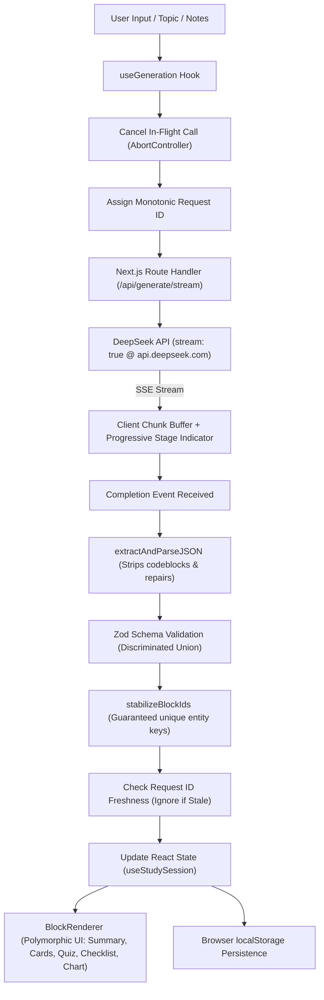

# ReWise — AI-Powered Active Learning Platform

> **Study smarter. Remember longer.**  
> Built for the Frontend Internship Assignment.

ReWise transforms unstructured lecture notes, educational articles, and textbook excerpts into structured, highly interactive active-learning blocks: **Conceptual Summaries**, **3D Flip Flashcards**, **Multiple-Choice Quizzes**, **Revision Checklists**, and **Quantitative Comparison Charts** with dedicated **Wrong-Answer Retesting**, **SSE Progressive Streaming**, and an **Intelligent AI Refinement Loop**.

Powered by **DeepSeek API** (`deepseek-flash`) using the official **OpenAI JavaScript SDK** with strict JSON Schema output mode and client-side Zod validation.

---

## 🌟 Key Capabilities & Stretch Implementations

### 1. Minimalist Monochromatic Dark Design System
- **Pure Black Aesthetic**: Designed with an ultra-clean, ChatGPT-inspired aesthetic (`#050505` canvas, `#101010` primary cards, `#141414` secondary surfaces, `#252525` hairline borders).
- **Zero Distracting Colors**: Replaced all saturated purples, blues, and neon gradients with monochromatic hierarchy, high-contrast white typography (`#F5F5F5`), and neutral gray secondary accents (`#A3A3A3`, `#737373`).

### 2. Advanced Motion Design & 3D Interactive Flashcards
- **CSS 3D Engine**: True two-sided card flip with `perspective: 1200px`, `transform-style: preserve-3d`, and `backface-visibility: hidden`.
- **Dynamic 3D Pointer Tilt**: Smooth, subtle tilt physics tracking cursor coordinates (`tiltX`, `tiltY` with 7° max rotation and spring return). Automatically disabled on touch screens (`pointer: coarse`) and when users activate system reduced motion (`prefers-reduced-motion`).
- **Framer Motion Micro-Interactions**: Orchestrated page entrances, staggered block roll-ins, and spring-eased state changes via a centralized motion system (`lib/motion.ts`).

### 3. Server-Sent Events (SSE) Progressive Streaming Generation
- **Real-Time Chunk Delivery**: Next.js route handler (`/api/generate/stream`) streams AI generation chunks in real time over HTTP SSE using official OpenAI SDK calling DeepSeek with `stream: true`.
- **Safe Progressive Validation Boundary**: Solves the core challenge of streaming structured JSON. Rather than rendering unstable partial JSON that could break UI invariants, ReWise buffers incoming tokens while driving an interactive **6-stage visual progress tracker** (`Analyzing`, `Structuring`, `Flashcards`, `Quiz`, `Validating`, `Finalizing`), validating with Zod only upon completion.
- **Client Cancellation**: Fully cancelable stream with immediate `AbortController` termination and byte counter.

### 4. Multiple Content Blocks & Quantitative Chart Block
- **Polymorphic Architecture**: Discriminated union supporting `summary`, `flashcards`, `quiz`, `checklist`, and `chart`.
- **Accessible Comparison Chart (`ChartBlock.tsx`)**: Renders comparative benchmark data using accessible horizontal bar charts, key insight callouts, and toggleable raw tabular views. Pure SVG/CSS architecture with zero heavy charting dependencies.

### 5. Smart Refinement Loop with Entity ID Preservation
- **State-Preserving Updates**: Learners can refine study content with natural language prompts (e.g., *"Make quiz questions harder"*, *"Add 4 more flashcards on edge cases"*, *"Include comparative metrics"*).
- **Entity Matching Algorithm (`mergeRefinedBlocks`)**: Matches existing flashcards, questions, and checklist items against new model responses. Unchanged entities retain their stable IDs, preserving user mastery tags, quiz answers, and checklist completions across iterative refinements.

### 6. Multiple-Choice Quiz & Dedicated Wrong-Answer Retest
- **Instant Pedagogical Feedback**: Option evaluation with detailed explanations and zero crossed-out/strikethrough text (clean dark red `#1B0F0F` highlight with explicit `"Your Choice (Incorrect)"` badges).
- **Targeted Retesting**: Isolates only missed questions into a dedicated retest phase, recalculates mastery scores, and celebrates 100% completion with canvas confetti.

### 7. Keyboard Accessibility Matrix
- **Flashcards**:
  - <kbd>Space</kbd> or <kbd>Enter</kbd>: Flip active flashcard.
  - <kbd>→</kbd> or <kbd>J</kbd>: Next card.
  - <kbd>←</kbd> or <kbd>K</kbd>: Previous card.
  - <kbd>1</kbd>: Mark as Mastered.
  - <kbd>2</kbd>: Mark as Needs Review.
- **Quiz**:
  - <kbd>1</kbd> – <kbd>6</kbd>: Select option index (automatically guarded against active text inputs).
- **Modals**:
  - <kbd>Escape</kbd>: Close active modal dialog.

### 8. Persistence & JSON Session Export / Import
- **Corrupt-Proof Local Storage**: Automatically validates sessions against `SavedSessionSchema` upon retrieval, quarantining malformed entries without crashing.
- **Session Backup & Portability**: Learners can download sessions as `.json` files and import them on other machines or restore past states.

---

## 🏗️ Architecture & Data Flow



---

## 📁 Project Structure

```
rewise/
├── app/
│   ├── api/
│   │   ├── generate/route.ts       # DeepSeek structured generation endpoint
│   │   ├── generate/stream/route.ts# SSE real-time streaming endpoint
│   │   └── refine/route.ts         # Targeted iterative DeepSeek refinement endpoint
│   ├── layout.tsx                  # Root layout, dark mode, metadata
│   ├── page.tsx                    # Main interactive study dashboard
│   └── globals.css                 # 3D CSS utilities and monochrome theme
├── components/
│   ├── blocks/
│   │   ├── BlockRenderer.tsx       # Discriminated union block dispatcher
│   │   ├── SummaryBlock.tsx        # Executive summary and key takeaways
│   │   ├── FlashcardBlock.tsx      # 3D flip card with pointer tilt & keyboard nav
│   │   ├── QuizBlock.tsx           # Multiple choice, feedback, and 1-6 shortcuts
│   │   ├── ChecklistBlock.tsx      # Revision tasks with progress tracking
│   │   └── ChartBlock.tsx          # Quantitative comparison visualization & table
│   ├── history/
│   │   └── SavedSessionsModal.tsx  # Manage, export, and import JSON sessions
│   ├── input/
│   │   ├── NotesInput.tsx          # Free-form input, difficulty, block selection
│   │   └── RefineBar.tsx           # Follow-up refinement prompt bar with chips
│   ├── layout/
│   │   ├── Header.tsx              # Top bar, status, quick actions
│   │   ├── Sidebar.tsx             # Collapsible session history drawer
│   │   └── MainLayout.tsx          # Responsive layout shell
│   ├── study/
│   │   ├── RetestSection.tsx       # Dedicated wrong-answer retesting interface
│   │   ├── SessionOverview.tsx     # Session title, difficulty, export, reload
│   │   └── StudyProgress.tsx       # Overall session mastery score gauge
│   └── ui/
│       ├── Badge.tsx               # Reusable difficulty and status pills
│       ├── Button.tsx              # Accessible button with states and variants
│       ├── Card.tsx                # Obsidian surface card container
│       ├── EmptyState.tsx          # Zero-state onboarding with sample topic chips
│       ├── ErrorAlert.tsx          # Resilient error alert with retry & diagnostics
│       ├── Skeleton.tsx            # Loading skeletons for generation
│       └── StreamingProgressIndicator.tsx # Progressive SSE visual stage tracker
├── hooks/
│   ├── useGeneration.ts            # SSE stream reader with monotonic request IDs
│   ├── useKeyboardNav.ts           # Accessible keyboard shortcuts for flashcards
│   └── useStudySession.ts          # Central state owner with smart refinement merge
├── lib/
│   ├── deepseek.ts                 # DeepSeek API client via OpenAI SDK (stream & batch)
│   ├── mockData.ts                 # Offline / fallback mock dataset with chart block
│   ├── motion.ts                   # Centralized Framer Motion animation presets
│   ├── prompts.ts                  # Structured system prompts and schema specs
│   ├── schemas.ts                  # Zod schemas for requests, responses, and storage
│   ├── storage.ts                  # LocalStorage serialization, import & corruption recovery
│   ├── studyLogic.ts               # Domain scoring, retesting, and smart ID merging
│   └── validation.ts               # JSON cleaner, codeblock stripper, ID stabilizer
├── tests/
│   ├── chart.test.ts               # Chart block schema & bounds verification
│   ├── deepseek-integration.test.ts# Live DeepSeek API generation & refinement tests
│   ├── refinement-merge.test.ts    # Smart entity ID preservation test suite
│   ├── retest.test.ts              # Scoring, wrong-answer retesting & stats tests
│   ├── schemas.test.ts             # Schema validation, bad AI output & edge cases
│   └── storage.test.ts             # LocalStorage corruption resilience tests
├── .env.example
├── package.json
├── tailwind.config.ts
├── tsconfig.json
└── vitest.config.ts
```

---

## 🛠️ Technology Stack

- **Framework**: Next.js 15 (App Router, Server Route Handlers)
- **Language**: TypeScript (Strict mode, zero implicit `any`)
- **Styling**: Tailwind CSS (Monochrome Dark System)
- **Animations & 3D**: Framer Motion + CSS 3D Transforms (`perspective`, `preserve-3d`, `backface-visibility`)
- **AI SDK**: Official `openai` JavaScript SDK connected to DeepSeek API
- **Model**: `deepseek-flash` (`baseURL: https://api.deepseek.com`, JSON mode)
- **Validation**: Zod (Discriminated unions, custom range refinements)
- **Icons**: Lucide React
- **Celebrations**: `canvas-confetti`
- **Testing**: Vitest + JSDOM (32 tests across 6 suites)

---

## 🚀 Getting Started

### 1. Fresh Checkout & Setup

```bash
# Clone the repository
git clone https://github.com/lokenderrao/Re-Wise.git
cd Re-Wise

# Install dependencies
npm install
```

### 2. Configure Environment Variables

Create a `.env.local` file in the root directory:

```bash
cp .env.example .env.local
```

Add your DeepSeek API key:

```env
DEEPSEEK_API_KEY=your_deepseek_api_key_here
DEEPSEEK_MODEL=deepseek-flash
```

> **Note on API Security:** The `DEEPSEEK_API_KEY` is accessed **strictly server-side** in Next.js route handlers (`app/api/*`) and is never leaked to the client bundle. `.env.local` is ignored by `.gitignore`.

### 3. Run the Application

Per the assignment specification, the application runs out of the box with:

```bash
npm start
```

*(Note: `npm start` automatically executes `prestart` to build `.next` if not already built, guaranteeing zero build missing errors).*

For local development with hot reload:

```bash
npm run dev
```

Open [http://localhost:3000](http://localhost:3000) in your browser.

---

## 🧪 Running Automated Tests

Run the complete Vitest test suite covering schema validation, live API calls, corrupted storage recovery, wrong-answer retesting, chart blocks, and smart refinement merging:

```bash
npm test
```

**32 tests across 6 suites pass:**
- **`tests/chart.test.ts`**: Verifies chart block schema, non-empty data arrays, unit formatting, and discriminated union integration.
- **`tests/refinement-merge.test.ts`**: Verifies that existing flashcard IDs, quiz question IDs, and checklist IDs remain identical across refinement updates.
- **`tests/deepseek-integration.test.ts`**: End-to-end integration tests confirming live structured generation and refinement with DeepSeek API.
- **`tests/schemas.test.ts`**: JSON fence stripping, outermost bracket extraction, rejection of invalid schemas, and bounds checking.
- **`tests/retest.test.ts`**: Dual-phase quiz scoring, wrong-answer isolation, and progress statistics.
- **`tests/storage.test.ts`**: LocalStorage syntax corruption recovery, quarantining invalid records, and preserving valid study sessions.

---

## 🛡️ Failure Handling Strategy (20% Evaluation Weight)

| Failure Scenario | Mitigation & Implementation |
| :--- | :--- |
| **Malformed JSON** | `extractAndParseJSON` extracts outermost `{ ... }` brackets and strips markdown fences before parsing. |
| **Invalid Schema / Missing Fields** | Zod schema validation checks types and array bounds. Emits readable diagnostic paths. |
| **Out-of-Bounds Quiz Answer Index** | `.refine(q => q.correctAnswerIndex >= 0 && q.correctAnswerIndex < q.options.length)` ensures quiz questions never reference invalid options. |
| **Streaming Chunk Failures** | SSE reader handles network interruptions gracefully; partial buffers are never committed to state until validated. |
| **Race Conditions** | `useGeneration` tracks monotonic `latestRequestIdRef` and cancels prior in-flight calls via `AbortController`. If a slow older request finishes after a faster newer request, the older result is safely discarded. |
| **DeepSeek Rate Limits (429) & Timeouts** | Server-side 35s timeout via `AbortController`. Errors are mapped to friendly HTTP status codes (`429`, `504`) with a one-click retry button. |
| **Corrupted `localStorage`** | `getSavedSessions` validates each session individually with Zod. Corrupted records are quarantined without crashing the app. |
| **Refinement State Reset** | `mergeRefinedBlocks` retains user mastery tags and answered questions by mapping unchanged entities back to their stable IDs. |
| **Offline / Missing API Key** | App provides an **"Instant Demo"** button that pre-loads a full mock session (with all 5 block types) for seamless evaluation without credentials. |

---

## 🤖 AI Usage Disclosure

In compliance with the assignment instructions:
- **AI Tools Used**: Used Claude/Gemini coding assistance for initial scaffolding, architectural planning, and generating synthetic pedagogical test fixtures.
- **Human Authorship & Decision Making**:
  - Designed the discriminated union data contract (`SummaryBlock`, `FlashcardBlock`, `QuizBlock`, `ChecklistBlock`, `ChartBlock`).
  - Architected the safe progressive streaming pipeline and client-side Zod validation boundary.
  - Implemented the CSS 3D flashcard physics with pointer tilt and accessibility guards (`prefers-reduced-motion`, `pointer: coarse`).
  - Engineered the entity-preserving smart refinement merging algorithm (`mergeRefinedBlocks`).
  - Formulated the defensive JSON sanitization and Zod range validation pipelines.
  - Designed the custom hooks (`useGeneration`, `useStudySession`, `useKeyboardNav`) and race-condition prevention pattern.

---

## 📄 License

MIT License. Developed for the Frontend Internship Assignment.
